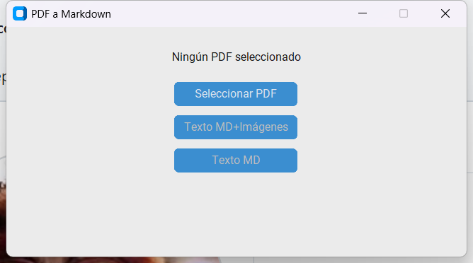

**[Leer en español](README.es.md)**

[](https://github.com/orcosto-lab/pdf2md/releases/latest)

# PDF to Markdown (PDF2MD)

Windows desktop app that converts PDF documents (technical manuals, articles,
etc.) to Markdown, with optional image extraction. Built to produce Markdown
content ready to use as context in conversations with LLMs.



## Features

- Simple graphical interface (customtkinter): select a PDF and save.
- Two export modes:
  - **MD text + images**: converts the text and extracts the PDF's images to
    a folder next to the `.md` file, with relative links.
  - **MD text only**: text only, no images.
- Page-by-page conversion: if a page fails, the error is noted in the output
  and the rest of the document is still processed instead of aborting.
- Heading hierarchy based on font size, tables rendered as Markdown, and
  correct reading order in multi-column documents (powered by
  [`pymupdf4llm`](https://pypi.org/project/pymupdf4llm/)).

## Download

The standalone Windows executable (`PDF a Markdown.exe`) is available in this
repository's [Releases](../../releases) section. No Python or additional
installation required.

## Build from source

Requirements: Python 3.11+ on Windows.

```powershell
# Create and activate a virtual environment
py -3 -m venv .venv
.venv\Scripts\activate

# Install dependencies
pip install -r Trabajo\requirements.txt

# Build the executable (from Trabajo\)
cd Trabajo
pyinstaller "PDF a Markdown.spec"
```

The resulting `.exe` is generated in `Trabajo\dist\`.

To run the script directly without building:

```powershell
python Trabajo\pdf2md.py
```

## Known limitations

- PDFs with irregular or complex column layouts (magazines, drop caps,
  double-column images) may end up with mixed-up text order — this is a
  limitation of `pymupdf4llm`'s layout engine, not something this tool
  controls.
- Some strict Markdown viewers that rely on relative paths (MarkBin,
  Notepad++'s MarkdownViewer++) don't display the extracted images even
  though the generated file is correct — confirmed to be a viewer limitation
  (MarkBin requires absolute paths), not a bug in this tool. Viewers
  confirmed to work well: Typora, Notepad++'s "Another Markdown"
  ([ezyuzin/NppAnotherMarkdown](https://github.com/ezyuzin/NppAnotherMarkdown)).

## License

MIT. See [LICENSE](LICENSE).
